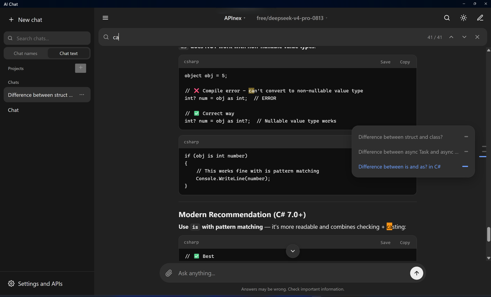
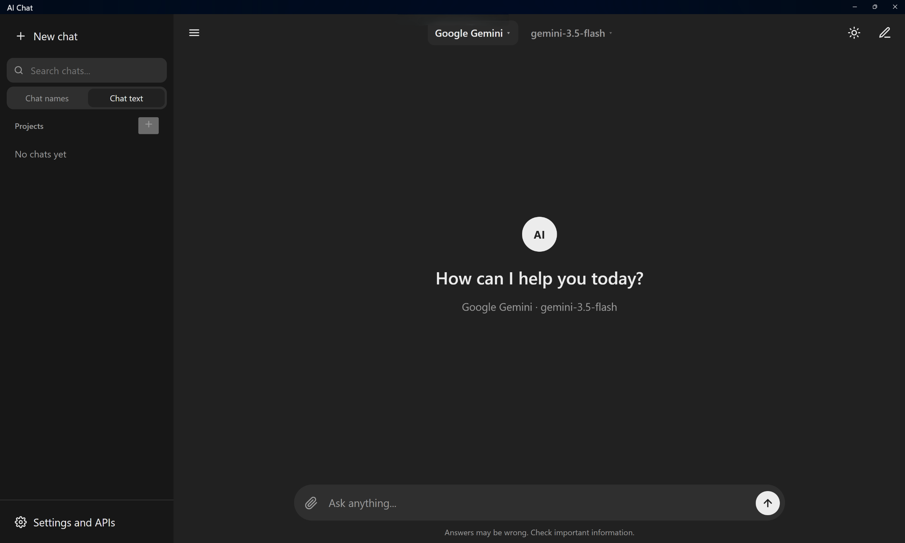
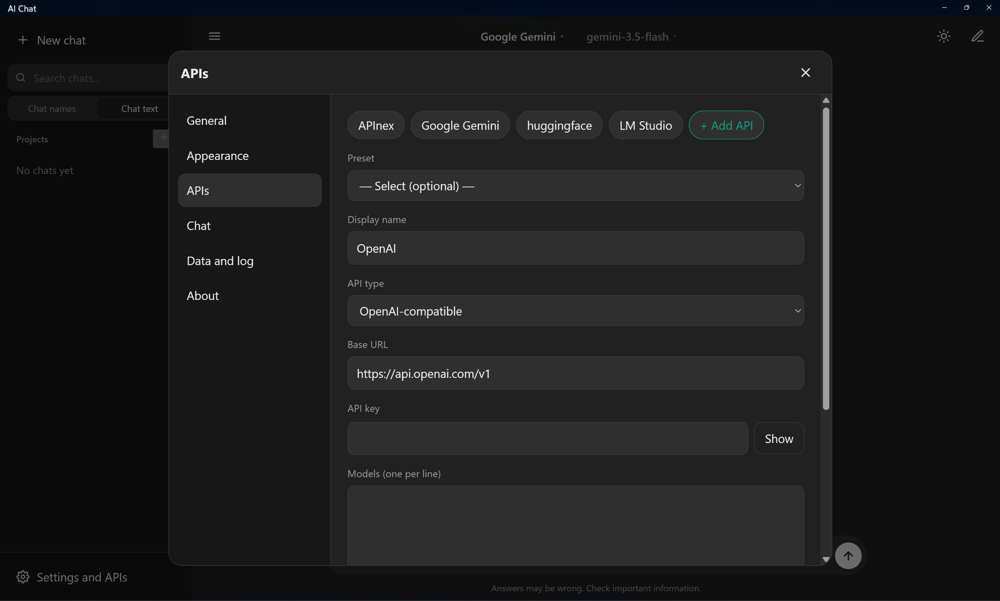

# 🚀 AI Chat Application

A modern, cross-platform ChatGPT-style application built for **Windows** and **Android** using C# and .NET 10 (.NET MAUI Blazor Hybrid). Connect your own API keys, seamlessly switch between AI providers, and keep all your chat history stored locally on your device.

## 📷 Screenshots

<p align="center">
  
  
  
</p>

## ✨ Features

### 🔌 Multi-Provider Support

* **OpenAI-Compatible APIs:** OpenAI, OpenRouter, DeepSeek, Groq, Mistral, xAI, Together, Ollama, LM Studio, or any custom endpoint using `/chat/completions`.

* **Direct Integrations:** Anthropic (Claude) and Google Gemini.

* **Flexible Management:** Configure multiple providers simultaneously, fetch model lists automatically, and retain model choices per provider.

* **Model Health Check:** Built-in "Test Models" utility to verify model functionality and rate limits before starting conversations.

### 🧩 Connectors (any API, no code)

* Describe any HTTP API in a small JSON profile: image / video / audio generators and chat APIs (Fooocus-API, ComfyUI, Stable Diffusion WebUI, your own server...).

* Long jobs with progress, percentage and a working **Stop** button; results as base64, URL or binary; the seed of every image is read back.

* 14 built-in templates, plus **Add from URL / catalog** with a preview of what a connector will do before you trust it. See [docs/CONNECTORS.md](docs/CONNECTORS.md) and the [connector catalog](https://github.com/CodeCraftDevHQ/AiChat-connectors).

### 💬 Chat Experience

* Real-time text streaming, full Markdown rendering, and code blocks with quick-copy/export options.

* Full support for RTL (Persian, Arabic) and LTR (English) languages.

* Edit sent messages with full version tracking (navigate history using `‹ n/N ›`).

* Organize chats with pinning, custom titles, full-text search across all conversations, and dynamic message navigation rails.

* **Projects:** Group chats together with shared system instructions and context files.

* **Web search** (🌐 button): DuckDuckGo, Brave, SearXNG or your own engine, optional page reading, sources under the answer. Works with any model.

* **Thinking box:** the reasoning of "thinking" models in a collapsible box (auto / open / closed / hidden).

* **Token & cost estimate** per answer and per chat, using your own price table.

* **Generation settings** (temperature, top-p, max tokens, system prompt) on three levels: global, per API, per chat.

* **Gallery** of everything the models generated, with filters, search and seed re-use.

* **Tools (function calling):** the model can get the date, calculate, search the web and read pages (OpenAI-compatible, Claude, Gemini). All calls of an answer are grouped in one collapsible box, with limits per answer and optional "ask before running". Tools are on by default.

* **MCP servers:** connect remote [MCP](https://modelcontextprotocol.io) servers (HTTP) or local programs (stdio, Windows) and give their tools to the model; per-tool on/off, headers kept in secure storage, import of the common `mcpServers` JSON.

* **Personas:** ready-made chat styles (system prompt, generation settings, API / model, tools on/off) picked from the welcome screen or per chat.

* **Code execution:** the model can run code to calculate exactly or process data. JavaScript runs in a built-in sandbox (no files, no network; Windows and Android); Python, PowerShell, CMD, Node.js, C# script or any program of your own can be added on Windows. Per language: on/off, ask before every run, clean environment, time limit, working folder.

* **Long-term memory:** facts and preferences the model remembers across chats (you can add, edit, import / export them; the model can save and forget with your approval; per chat / persona override; "suggest memories from this chat").

* **Automatic summary of long chats:** older messages are replaced by a summary for the model only, with your own limits, a separate summary model and a banner you can edit.

* **Select many chats** in the sidebar to delete them or move them to a project.

* **Settings search:** find any setting by name (Persian or English); the group opens and the setting is highlighted.

* **Prompt library:** your own `/commands` with a searchable picker (📚) and a full editor with import / export.

* **Project knowledge base:** documents of a project (txt, md, csv, json, html, docx, pptx, xlsx, pdf) are searched with a Persian-aware BM25 index (optional embeddings); the best passages go with your question or the model searches them as a tool; sources under the answer; a folder on the computer can be synced. The model can also search and read the other chats of the project.

* **Local server (Windows):** an OpenAI-compatible API and an MCP endpoint on `127.0.0.1`, protected by a bearer token, so other apps and tools can use your APIs, chats and project knowledge.

* **Favourite models & quick switch:** star models, see recent ones, switch with `Ctrl+K`, and give each model its own system prompt.

* **Tags & templates:** label chats and filter the chat list by tags; start a chat from a template (persona, API + model, tools, memory, project, extra prompt, tags).

* **Two-model chat and compare:** send a message to two models at once (both can use tools) or compare two models on one question.

* **Appearance & shortcuts:** accent / bubble colours, bubble shape, spacing, extra themes, and configurable keyboard shortcuts on the computer.

### 📎 Attachments & File Handling

* Attach images, documents (PDFs), and plain text via drag-and-drop, clipboard paste, or file selection (supports camera input on mobile).

* Smart PDF parsing: Send as raw extracted text or as native documents (supported by Claude and Gemini).

* Auto-fallback for image rejection if a provider does not support vision capabilities.

### 🎨 Personalization & Privacy

* Interface localized in Persian and English.

* Dark, Light, and System theme modes.

* Complete visual control: customize typography, layout width, line spacing, and font sizes.

* **App lock** (PIN, auto-lock after leaving the app) and **backup / restore** of everything into one zip file.

* **Privacy First:** API keys are stored in native secure storage (Android Keystore / Windows Credential Vault). Chats, projects and attachments are saved only on your device; message text and attached files are sent only to the AI services you configure yourself.

## ⬇️ Download

Ready-to-install builds are available on the [Releases](../../releases) page:

* **Windows:** `AiChat-Setup-<version>.exe`. No admin rights needed; the installer also installs the Microsoft Edge **WebView2 Runtime** if your PC does not have it yet.

* **Android:** `AiChat-android.apk` (allow installing from this source).

## 🛠️ Build & Installation

### Prerequisites

* Visual Studio 2022 / 2026 with **.NET Multi-platform App UI** workload.

* **.NET 10 SDK** installed.

### Build via CLI

```bash
# Clone the repository
git clone https://github.com/CodeCraftDevHQ/AiChat.git
cd AiChat

# Build for Windows
dotnet build -f net10.0-windows10.0.19041.0

# Build for Android
dotnet build -f net10.0-android
```

Alternatively, open `AiChat.csproj` in Visual Studio, select your target platform (**Windows Machine** or an **Android Emulator**), and press `F5` to run.

### Run the tests

```bash
dotnet test tests/AiChat.Tests
```

The unit tests cover the connector engine, providers, web search, token estimates and more. They run on every push through GitHub Actions (*CI*).

## 🚀 Getting Started

1. Navigate to **Settings → APIs → Add API**.

2. Pick a preset or choose **OpenAI-compatible** to input a custom Base URL.

3. Enter your API Key, fetch the available models, and save.

4. Select your preferred provider and model from the top navigation bar to start chatting!

## 📁 Project Architecture

| Directory | Description | 
| ----- | ----- | 
| `Services/` | Core business logic, API clients, connector engine, state management, storage, and localization. | 
| `Components/` | Razor components for UI rendering (Chat view, Sidebar, Modals, Settings, Gallery). | 
| `Models/` | Strongly typed data models and entity definitions. | 
| `wwwroot/` | Static assets, global CSS styling, and JavaScript interoperability scripts. | 
| `Platforms/` | Native platform-specific implementations for Android and Windows. | 
| `tests/` | xUnit tests. | 
| `docs/` | Screenshots and the [connector guide](docs/CONNECTORS.md). | 

`AiChat.iss` in the repository root is the Windows installer script (Inno Setup).

## 📦 Releasing

1. Raise the version in `AiChat.csproj` (`ApplicationDisplayVersion`, `ApplicationVersion`) and `AiChat.iss`, and add a line to [CHANGELOG.md](CHANGELOG.md).

2. Push a tag: `git tag v1.1.0 && git push origin v1.1.0`.

The *Release* workflow builds the Windows installer and the Android APK and attaches them to a GitHub Release. Optional secrets for a stable Android signing key: `ANDROID_KEYSTORE_BASE64`, `ANDROID_KEYSTORE_PASSWORD`, `ANDROID_KEY_ALIAS`.

## 🌐 Localization

UI texts use the Persian text as the key, for example `L["گفتگوی جدید"]`. English translations live in `Services/Translations.cs`:

```csharp
["گفتگوی جدید"] = "New chat",
```

Add or fix an entry there; a missing entry simply falls back to the Persian text. Adding a completely new language also needs a second dictionary and a language option in `Services/Loc.cs` and the settings dialog.

## 📄 License

This project is licensed under the [MIT License](LICENSE).
