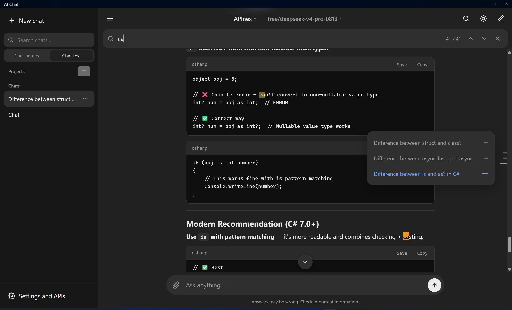
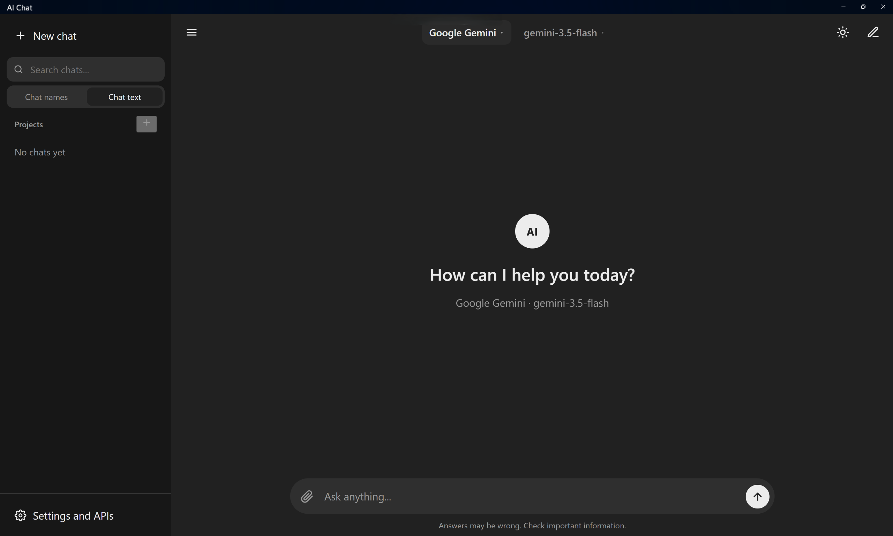
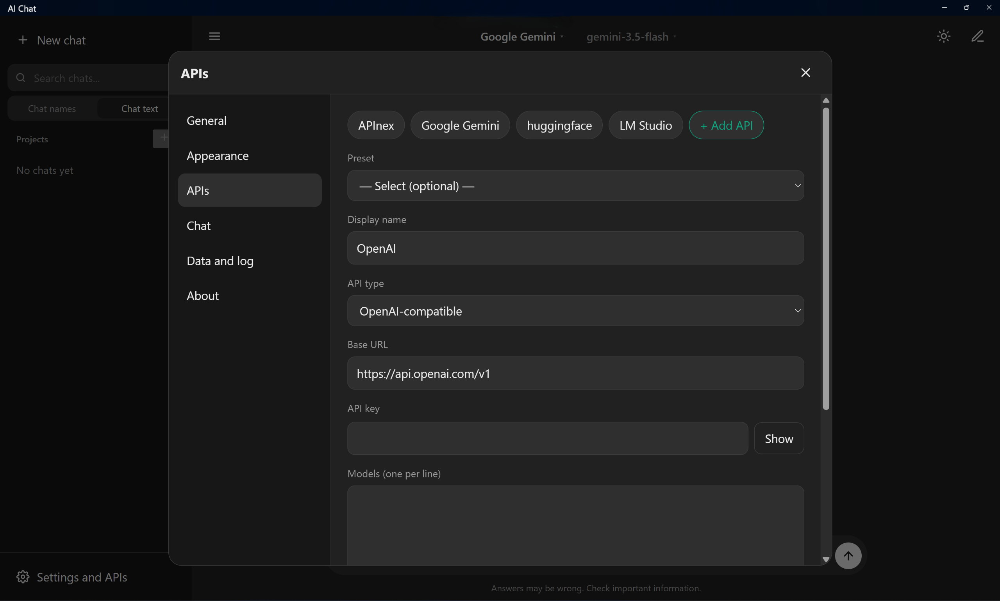

# 🚀 AI Chat Application

A modern, cross-platform ChatGPT-style application built for **Windows** and **Android** using C# and .NET 10 (.NET MAUI Blazor Hybrid). Connect your own API keys, seamlessly switch between AI providers, and keep all your chat history stored locally on your device.

## 📷 Screenshots

<p align="center">
  
  
  
</p>

## ✨ Features

### 🔌 Multi-Provider Support

* **OpenAI-Compatible APIs:** OpenAI, OpenRouter, DeepSeek, Groq, Mistral, xAI, Together, Ollama, LM Studio, or any custom endpoint using `/chat/completions`.

* **Direct Integrations:** Anthropic (Claude) and Google Gemini.

* **Flexible Management:** Configure multiple providers simultaneously, fetch model lists automatically, and retain model choices per provider.

* **Model Health Check:** Built-in "Test Models" utility to verify model functionality and rate limits before starting conversations.

### 💬 Chat Experience

* Real-time text streaming, full Markdown rendering, and code blocks with quick-copy/export options.

* Full support for RTL (Persian, Arabic) and LTR (English) languages.

* Edit sent messages with full version tracking (navigate history using `‹ n/N ›`).

* Organize chats with pinning, custom titles, full-text search across all conversations, and dynamic message navigation rails.

* **Projects:** Group chats together with shared system instructions and context files.

### 📎 Attachments & File Handling

* Attach images, documents (PDFs), and plain text via drag-and-drop, clipboard paste, or file selection (supports camera input on mobile).

* Smart PDF parsing: Send as raw extracted text or as native documents (supported by Claude and Gemini).

* Auto-fallback for image rejection if a provider does not support vision capabilities.

### 🎨 Personalization & Privacy

* Interface localized in Persian and English.

* Dark, Light, and System theme modes.

* Complete visual control: customize typography, layout width, line spacing, and font sizes.

* **Privacy First:** API keys are stored in native secure storage (Android Keystore / Windows Credential Vault). Chats, projects and attachments are saved only on your device; message text and attached files are sent only to the AI services you configure yourself.

## ⬇️ Download

Ready-to-install builds (Windows installer and Android APK) are available on the [Releases](../../releases) page.

## 🛠️ Build & Installation

### Prerequisites

* Visual Studio 2022 / 2026 with **.NET Multi-platform App UI** workload.

* **.NET 10 SDK** installed.

### Build via CLI

```bash
# Clone the repository
git clone https://github.com/CodeCraftDevHQ/AiChat.git
cd AiChat

# Build for Windows
dotnet build -f net10.0-windows10.0.19041.0

# Build for Android
dotnet build -f net10.0-android
```

Alternatively, open `AiChat.csproj` in Visual Studio, select your target platform (**Windows Machine** or an **Android Emulator**), and press `F5` to run.

## 🚀 Getting Started

1. Navigate to **Settings → APIs → Add API**.

2. Pick a preset or choose **OpenAI-compatible** to input a custom Base URL.

3. Enter your API Key, fetch the available models, and save.

4. Select your preferred provider and model from the top navigation bar to start chatting!

## 📁 Project Architecture

| Directory | Description | 
| ----- | ----- | 
| `Services/` | Core business logic, API client handlers, state management, storage, and localization. | 
| `Components/` | Razor components for UI rendering (Chat view, Sidebar, Modals, Settings). | 
| `Models/` | Strongly typed data models and entity definitions. | 
| `wwwroot/` | Static assets, global CSS styling, and JavaScript interoperability scripts. | 
| `Platforms/` | Native platform-specific implementations for Android and Windows. | 

## 🌐 Localization

UI texts use the Persian text as the key, for example `L["گفتگوی جدید"]`. English translations live in `Services/Translations.cs`:

```csharp
["گفتگوی جدید"] = "New chat",
```

Add or fix an entry there; a missing entry simply falls back to the Persian text. Adding a completely new language also needs a second dictionary and a language option in `Services/Loc.cs` and the settings dialog.

## 📄 License

This project is licensed under the [MIT License](LICENSE).